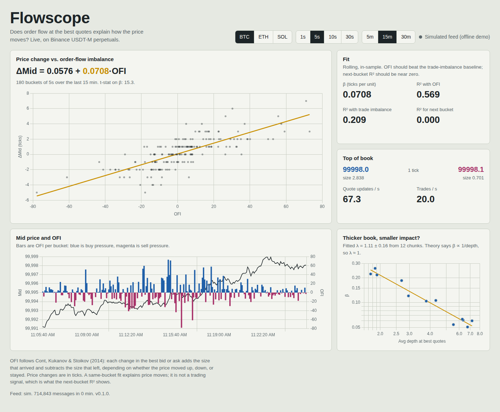

# Flowscope

A live order-flow terminal for Binance USDT-M perpetuals. It streams the best bid/ask and trades over WebSocket, computes **order-flow imbalance (OFI)** on every quote change, and shows in real time how much of each price move order flow explains. In effect, it's a live replication of Cont, Kukanov & Stoikov (2014) on crypto.



What the dashboard shows:

- **ΔMid vs. OFI scatter** with a rolling least-squares fit, plus β and its t-stat.
- **R² with OFI vs. R² with trade imbalance:** OFI should win.
- **Next-bucket R²:** the honest check. Explaining a move is not predicting it.
- **Depth scaling:** β per chunk of history against average depth, with a fitted λ. Theory says β ∝ 1/depth, so λ ≈ 1.
- Top of book, spread in ticks, and quote/trade rates.
- Switches for symbol, bucket size (1/5/10/30 s) and window (5/15/30 min).

## Run it

```bash
pip install -r requirements.txt
uvicorn flowscope.app:app --port 8000      # live Binance data
# open http://localhost:8000
```

Live mode needs time to build history: the first fit appears after about 100 s at 5 s buckets, and the depth panel takes longer.

**No internet, or Binance blocked where you are?** Run the simulated feed. It back-fills 40 minutes of history, so the charts are full on load:

```bash
FEED=sim uvicorn flowscope.app:app --port 8000
```

### Record and replay real data

```bash
mkdir -p recordings
RECORD_PATH=recordings/btc.jsonl uvicorn flowscope.app:app              # record while live
FEED=replay REPLAY_PATH=recordings/btc.jsonl REPLAY_SPEED=10 uvicorn flowscope.app:app
```

Replay is the most reliable way to demo real data without depending on the network.

## Configuration

| Variable | Default | Meaning |
|---|---|---|
| `FEED` | `binance` | `binance`, `sim`, or `replay` |
| `SYMBOLS` | `BTCUSDT,ETHUSDT,SOLUSDT` | Any USDT-M perps |
| `BINANCE_WS_URL` | `wss://fstream.binance.com` | Override if Binance changes endpoints |
| `BINANCE_REST_URL` | `https://fapi.binance.com` | Fetched once at startup for tick sizes |
| `RECORD_PATH` | unset | Append raw messages as JSONL |
| `REPLAY_PATH`, `REPLAY_SPEED` | unset, `1` | Replay a recording |
| `HISTORY_SEC` | `7200` | Seconds of 1 s buckets kept in memory |
| `SIM_WARMUP` | `2400` | Seconds of back-filled history in sim mode |

## Deploy

Binance futures rejects US IP addresses, so deploy in a non-US region.

- **Docker:** `docker build -t flowscope . && docker run -p 8000:8000 flowscope`
- **Render:** push the repo, then New → Blueprint. It reads `render.yaml`, which sets the Singapore region. The free tier sleeps when idle and loses history; use a paid instance for an always-on demo.
- **Fly.io:** `fly launch --copy-config && fly deploy`. `fly.toml` pins `sin` and keeps one machine running.

## How it works

```
Binance WS (bookTicker + aggTrade)  — or simulated / replayed messages, same format
        │
        ▼
dispatch → SymbolEngine, one per symbol
             • prices held as integer ticks
             • e_n per best-quote change, summed into 1 s buckets
             • signed taker volume per bucket (baseline)
        │
        ▼
snapshot(bucket, window): aggregate to k-second buckets → OLS fits + depth-scaling fit
        │
        ▼
FastAPI: /ws pushes a snapshot every second · /api/snapshot · /api/health
        │
        ▼
static dashboard (Chart.js)
```

OFI for update *n* (prices in ticks):

```
e_n = 1{Pb_n ≥ Pb_{n-1}}·qb_n − 1{Pb_n ≤ Pb_{n-1}}·qb_{n-1}
    − 1{Pa_n ≤ Pa_{n-1}}·qa_n + 1{Pa_n ≥ Pa_{n-1}}·qa_{n-1}
```

Code map:
- `flowscope/engine.py`: OFI, buckets, fits
- `flowscope/feeds.py`: Binance, replay, simulator
- `flowscope/app.py`: API and WebSocket
- `flowscope/static/index.html`: UI

## Tests

```bash
pip install -r requirements-dev.txt && pytest -q
```

The suite covers:
- hand-computed e_n for every bid/ask move
- bucket and ΔMid logic
- Binance message parsing
- an end-to-end simulated pipeline (OFI must explain ΔMid and beat trade imbalance)
- API and WebSocket smoke tests

## Limitations

- Fits are rolling and in-sample. Plain OLS t-stats ignore autocorrelation, so treat them as indicative.
- Buckets use exchange event time; the next-bucket number ignores latency.
- The depth-scaling fit drops chunks with β ≤ 0.
- The simulator is a toy queue model for offline demos, not evidence about real markets.
- Research and education only. Not trading advice.

Reference: R. Cont, A. Kukanov, S. Stoikov, "The Price Impact of Order Book Events," *Journal of Financial Econometrics* 12(1), 2014. [arXiv:1011.6402](https://arxiv.org/abs/1011.6402)
